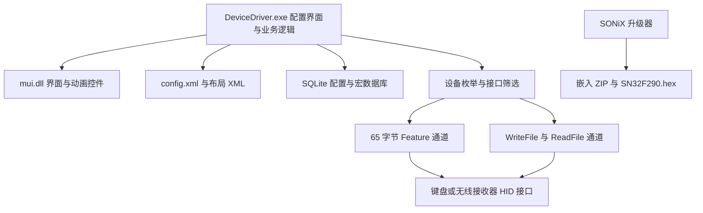

# GANSS GS3104T PRO 驱动逆向报告

分析日期：2026 年 11 月 8 日。对象为本项目提供的 Windows 配置软件、安装程序及固件升级器。

本软件的主体是 32 位 C++ 用户态配置程序，通过 Windows HID API 向键盘发送私有协议。已还原 HID 传输封装、主要配置事务、部分键位及灯光数据布局，并恢复了随包官方 EXE 中实际用于此键盘的 PE 固件资源和 `20 03` 更新事务。灯光、部分映射及 ISP 查询已有 Linux 实机记录，完整固件写入流程已与官方 Windows 抓包逐块核对；Linux 完整实机刷写和宏指令仍有未验证范围。

主体采用静态分析与隔离函数模拟；分析工具不执行 Windows 主程序，也未在 Linux 上刷写固件。用户随后提供了 Windows 官方工具的真实成功刷写记录，相关结果见下节。Linux 部分实机验证详见文末及实机测试记录。报告中的“确认”表示文件或反汇编直接支持；“推断”表示由调用顺序、数据结构及配置用途推导。静态恢复的模式清单不等于逐项完成实机验证，断电持久化尚未验证。

## 固件升级最终确认与 0.3.2 修复（Windows 抓包补充）

**本节更正后文早期以 ZIP 中 `SN32F290.hex` 作为目标固件的判断。** 同一个官方 EXE 同时含有归档模板与实际固件。归档 HEX 的 256 KiB、`20 05`、USB `0C45:8801` 等描述，均不能用于当前旧版键盘的升级。此前据此作出的兼容性或容量推断撤回；Windows 成功证据现已得到逐字节核实。

用户提供 `GS3104T-official-update.pcapng`，SHA256 为 `2255815a117f5d0bc6eb13a6db1a94b4796e5f3e0dca73be0bf10fb475b05644`。其中 1032 笔 HID Feature 事务全部 USB 状态成功，包含 1029 笔 OUT、3 笔 IN。所有固件数据可在原 EXE 中一次性连续定位：

| 项目 | 结果 |
| --- | --- |
| PE 资源 | 类型 10（RCDATA）/ ID 4000 / 语言 0 |
| 资源 RVA / 文件偏移 | `0x1C564C` / `0x1B964C` |
| 大小 | 完整 65536 字节，不是截断归档 HEX |
| SHA256 | `42924f581b208c23ea4818c6a4d6db59669dfb4059074b99b635a2ee13c73fed` |
| 向量表开头 | `08 17 00 20 31 68 00 00` |
| 末尾标记 | `0xFFFC: 55 55 AA AA` |
| 固件内 USB 描述符 | `0x6BA2: 12 01 00 02 00 00 00 40 AC 05 4F 02 20 01 01 02 00 01` |
| 资源 4008 / 4009 | UTF-16LE `05AC` / `024F` |
| 资源 4010 | UTF-16LE `SN32F24xB`，官方目标标签 |
| 资源 4012 | 字节 1，原厂保护配置等级 |
| 资源 4013 | `Build time:2025/07/22 10:54` |
| 资源 4014 | UTF-16LE `2765` |
| 资源 4016 | UTF-16LE `SN32F240B_32.hex`，资源内文件名标签 |

`0x4261D4..0x426276` 明确调用 FindResource（类型 10、ID 4000）、LoadResource、LockResource、SizeofResource，然后把该资源复制进更新缓冲区。资源 4010 及查询 `20 03` 对应所选的 SN32F24xB / 通用索引 14 路径；ZIP 内的 SN32F290 文件并未用于此次实际刷写。

实际事务如下，偏移均相对 USB 传输的 64 字节业务数据，不含 hidraw API 合成的 Report ID 零前缀：

| 抓包帧 | 操作 | 有效内容 |
| --- | --- | --- |
| 121 | 进入 ISP | `AA 42 89 5A FF 71 62 CC` |
| 123 / 125 | 查询 / 响应 | `01 AA 55 00`；响应 ACK 为 `FA FA FA FA`，8..11 为 `20 03 00 00`，12..15 为 `00 00 5A 5A` |
| 127 | 保留 Code Option | `03 AA 55 00 00 00 5A 5A`，没有独立的命令 02 或 04 |
| 129 / 131 | 写入请求 / ACK | `05 AA 55 00 00 00 00 00 00 04`，即 1024 个块；ACK 正确 |
| 133..2179 | 固件数据 | 1024 个 64 字节原始块，无额外块头；拼接结果与 RCDATA/4000 全部相等 |
| 2181 | 最终校验 | `05 AA 55 00 FA FA FA FA 65 27 ...`，业务偏移 8..9 为 `0x2765` |
| 2183 | 返回用户模式 | `07 AA 55 00`，其余补零 |
| 2206 | 更新后描述符 | `05AC:024F` / bcdDevice `0x0120`，与真实 PE 固件内描述符相同 |

数据块起始间隔中位数约 10 毫秒，与旧版原厂路径一致。命令包中有效字段之后出现的 Windows 进程内存不属于升级参数；Linux 将其补零。只有真正的固件块逐字节复制资源，不复制未初始化内存。

Linux 后端 0.3.2 修复三处根因：加载正确 PE 资源；接受同一物理端口保留原 USB 身份的有效 ISP 握手；采用 `20 03` 的 `01→03→05→数据→校验→07` 分支。只接收随包镜像，核对其大小、SHA256、向量和标记，核对 ISP ID 及已验证的 `5A 5A` 保护状态。握手结果复用，完整后台事务不额外插入一次芯片查询。

完整后台任务已使用此抓包的真实三次响应做离线回放，1024 个块和所有有效控制字段相等；同时验证错误校验不复位、错误保护/ID 在持久修改前拒绝、同端口选择及诊断不写入。81 项测试通过，构建出的 Arch 包在独立解包目录再次通过同一套测试。**本轮没有再次操作真实键盘；Linux 完整刷写尚未实机验证。** 这些限制保留在 API 元数据中，不将 Windows 证据冒充为 Linux 实机成功。

原始抓包只在本地 `local/captures/` 归档，不随仓库发布。复现：`python analysis/tools/verify_official_capture.py` 生成 [windows-update-verification.json](evidence/windows-update-verification.json) 和 `firmware/official-rcdata-4000.bin`。修复版本说明见 [固件更新后端](../docs/firmware-update.md)。后文的旧模板和待确认记录保留用于追溯，均以本节最终证据为准。

## 样本及版本

| 对象 | 大小 | 识别结果 |
| --- | ---: | --- |
| `GS3104T-PRO/DeviceDriver.exe` | 2,207,744 字节 | PE32 i386 GUI，ImageBase `0x400000` |
| `GS3104T-PRO/mui.dll` | 1,195,008 字节 | PE32 UI 库，导出 `MUI` 命名空间的界面控件 |
| `驱动程序-GS3104T-PRO Driver-1.0.0.3.exe` | 5,812,900 字节 | Inno Setup 6.1.0 Unicode 安装包 |
| `DSM318_108K_RGB三模_HFD64KC200_V1.20_20250722_0x2765.exe` | 2,037,760 字节 | SONiX 固件升级工具，资源版本 `2.1.2.6` |

主程序 SHA256：

```text
1fa6591f5e48a7417076ac244cd886aa6407434f45138ce9932c46dca4cf2b33
```

升级器 SHA256：

```text
1191ad14fabd9c448d45622bab257947464c1c32432aec2d5fd3a1eb04b2e64f
```

全部输入文件的长度和 SHA256 见 [sample-manifest.json](evidence/sample-manifest.json)。从安装包解出的主程序、`config.xml`、键盘布局 XML 均与现有目录对应文件逐字节一致，见 [installer-comparison.json](evidence/installer-comparison.json)。安装包有重复主程序条目，该比较针对解包后的最终文件。

软件 XML 自报 `Beta 1.0.0.3`，主程序 PE 时间戳为 `2025-01-17 14:19:30 UTC`；固件名标注 `V1.20_20250722`，布局 XML 的固件版本字段为 `120`。目录名含 `20241015`，不能据此认定其中所有文件都发布于该日期。升级器的 PE 时间戳为 2021 年，也不能代替嵌入固件的构建日期。

## 软件结构



提供的安装内容中未发现 `.sys` 或 `.inf`。主程序动态加载 `hid.dll`，通过 SetupAPI 枚举设备，使用系统 HID 栈访问设备。`mfc140u.dll`、`msvcp140.dll`、`vcruntime140.dll` 为随包运行库；`mui.dll` 的导入及导出体现了绘图、界面和动画功能，未在其导入表中看到 HID 或 SetupAPI。

主程序中内嵌 SQLite 实现及建表语句，因此不能把大量数据库内部字符串误判为设备协议。数据库路径格式为 `db\%s_datav1.db`，本目录没有现成用户数据库；本次恢复的是建表结构，而非用户配置内容。

## 设备识别与功能开关

### 上位机配置中的匹配条件

来源：[config.xml](evidence/config.xml)。

| 模式 | mode 值 | VID | PID | 产品名 | 接口匹配字符串 |
| --- | ---: | --- | --- | --- | --- |
| USB | 0 | `05AC` | `024F` | `GS3104T PRO` | `VID_05AC&PID_024F&MI_00` |
| 2.4G TYPE A | 2 | `05AC` | `024F` | `GS3104T-PRO 2.4G` | `VID_05AC&PID_024F&MI_03` |

配置未列出蓝牙控制接口。界面存在蓝牙图标，不能据此认定本上位机实现了蓝牙配置通道。VID/PID 是配置文件中的匹配值，不能单独用于判断硬件厂商或芯片型号。

`0x450AA0` 负责 HID 枚举，`0x450F20` 打开设备路径，并通过 `HidD_GetPreparsedData`、`HidP_GetCaps` 读取报告长度。`0x44F910` 根据能力值建立设备记录；`0x44FDD0` 选择并缓存当前设备句柄，优先查找模式 0，再查找 1、2。

### 布局配置

来源：[rgb-keyboard.xml](evidence/rgb-keyboard.xml)、[layout-summary.json](evidence/layout-summary.json)。

有线菜单启用宏、灯效、用户灯光、自定义灯光、音乐功能，关闭侧灯与屏幕。无线菜单启用宏、灯效、用户灯光、音乐，关闭侧灯与屏幕；其中未出现 `custom_light` 属性，不能仅据此确定无线自定义灯光的最终界面行为。

Fn 层、休眠时间、按键响应时间开关均为 1。默认灯效编号 11，亮度 5，速度 3，亮度和速度上限均为 5。命令延迟配置为 35；通信代码通过 `Sleep` 使用毫秒延迟，另有 3、5、10、30、50 毫秒等局部等待。

XML 中虽存在 `128×128` 屏幕参数，但菜单明确 `screen="0"`，不能据此认定该型号有可用屏幕。

## HID 传输协议

### 地址约定与证据

以下函数名均为本次分析命名，地址为主程序首选基址下的 VA。重定位后应按 `实际模块基址 + VA - 0x400000` 查找。`.text` 文件偏移换算为 `VA - 0x400C00`。

完整反汇编见 driver-disasm.txt（本地生成文件，见 [材料说明](README.md)），相关片段见 [protocol-disasm.txt](evidence/protocol-disasm.txt)。

| VA | 分析命名 | 已确认行为 |
| --- | --- | --- |
| `0x450990` | load_hid_api | 加载 `hid.dll` 并解析 HID 函数 |
| `0x450F20` | open_hid_path | 打开设备路径，读取 Input、Output、Feature 长度 |
| `0x4510C0` | hid_write | 按 OutputReportByteLength 补零，调用重叠 `WriteFile` |
| `0x4511A0` | hid_read_timeout | 重叠 `ReadFile`，支持超时；首字节为 0 时移除首字节 |
| `0x4512E0` | set_feature65 | 固定长度 `0x41` 调用 `HidD_SetFeature`，成功返回 65，失败返回 -1 |
| `0x451380` | get_feature_ioctl | 用 `DeviceIoControl(0xB0192)` 读取 Feature，输入输出共用缓冲区 |
| `0x44ED70` | feature_send | 单包发送及可选确认；大块数据按 64 字节切片 |
| `0x44EF60` | feature_exchange | 发包后读取响应，处理状态 `FF` 的分支并复制返回内容 |
| `0x44F240` | feature_read_blocks | 发起查询、确认后读取最多 9 块数据 |
| `0x44F490` | short_exchange | 计算累加校验，写入短报文并轮询响应 |
| `0x44F630` | short_probe | 构造探测请求，检查返回命令字 |

`HidD_SetFeature` 动态函数指针保存在 `0x5950A0`。`HidD_GetFeature` 虽被解析到 `0x59509C`，当前静态交叉引用没有发现实际调用；主要读 Feature 的封装走 `DeviceIoControl`，不能仅按导入字符串描述其执行路径。

### 65 字节 Feature 封装

定义 `P` 为调用者构造的业务数据，`H` 为传入 Windows HID API 的缓冲区。

```text
H[0]      = 00
H[1..64]  = P[0..63]
API 长度  = 65 字节
```

直接证据为 `0x44EDDF` 清零 65 字节，`0x44EDF7` 起把业务数据复制到缓冲区 `+1`，`0x44EE16` 调用 `0x4512E0`。`P[0]=04` 是常见业务前缀，在该通道上不能当作 HID Report ID。API 缓冲区首字节为 0；USB 总线上的数据表示仍应与抓包工具的 HID 封装方式区分。

调用者经常传入逻辑长度 65，但封装实际复制 64 字节业务数据。对于业务长度大于 65 的发送，`0x44EE75` 使用 `length >> 6` 计算块数，每块 64 字节、每次 HID API 调用 65 字节；没有通用尾块补齐逻辑。调用者必须预先处理对齐，不能把任意长度文件直接交给此分块函数。

带确认的单包分支在读取后检查 `H[4] == 01`，即去除 API 首字节后的 `P[3] == 01`。这是上位机采用的成功判断，完整响应的字段意义仍需抓包确认。长块发送分支不逐块执行同样的状态检查，并在发送失败时最多追加 10 次重试。

下面的伪代码保留了关键偏移，略去设备选择和等待逻辑：

```python
def wrap_feature(payload64):
    assert len(payload64) == 64
    return b'\x00' + payload64

# 常见单包路径
H = wrap_feature(P[:64])
HidD_SetFeature(handle, H, 65)
# 调用者要求确认时，随后读取 Feature 并检查 H[4] == 1
```

### 短报文通道

`0x44F490` 使用另一种布局：直接复制调用者缓冲区，不额外插入零字节，并向 `hid_write` 请求写入 `0x21`，即 33 字节。`hid_write` 随后可能按设备报告长度补零，因此 33 字节是上层请求长度，不一定是最终 `WriteFile` 长度。

校验计算的准确表达为：

```text
sum = 调用时 S[0 .. length-1] 所有字节之和
S[0x20] = sum & 0xFF
```

该算法在覆盖校验字段之前执行；调用者通常先把缓冲区清零，所以初始校验字段通常为零。多个调用传入 length=65，不能未经检查便把规则概括成“只累加前 32 字节”。若尾部数据不为零，它们也会参与上位机的计算。

常见短报文包含 `S[1]` 命令、`S[2]` 长度或参数、`S[3]` 块序号、`S[4...]` 数据、`S[32]` 校验。`0x44F5C5` 起把请求 `S[1..3]` 与读函数返回的前三字节比较，最多轮询 20 次，每次读超时参数 5 毫秒，失败间隔 10 毫秒。读函数会剥离值为 0 的首字节，解释响应偏移时必须包含这一行为。

### 多块读取

`0x44F240` 先发送请求并读取确认，检查 `H[4]==1`，随后继续读取最多 9 块，每次从接收缓冲区 `+1` 复制 64 字节。代码检查单次读取耗时是否超过 `0x168`，即 360 毫秒。它并不等同于整个多块事务只有 360 毫秒总超时。

## 主要业务命令与事务

表中偏移均相对业务数据 `P`，排除 Feature API 补入的首字节。用途是结合调用上下文得出的解释；命令字节和地址有直接指令证据。

| 字节前缀或命令 | 调用位置 | 用途与证据强度 |
| --- | --- | --- |
| `04 18` | `0x414270`、`0x418626`、`0x42B0DF` 等 | 多种写配置流程的前置命令，推断为事务准备 |
| `04 02` | `0x41443D`、`0x418D54`、`0x42B18F` 等 | 配置发送后的公共收尾，推断为提交或结束；不等于已确认写 Flash |
| `04 F0` | `0x418DC4`、`0x42B1B9` 等 | 部分配置收尾后的附加通知，具体语义待验证 |
| `04 17`，`P[2]=1`，`P[8]=1` | `0x41428F` 起 | 通用设置写入前导，随后发送包含响应时间、休眠等数据的块 |
| `04 11` 或 `04 27`，`P[8]=9` | `0x418640` 起 | 两种键位层数据写入选择，随后发送 576 字节键位表；对应普通层与 Fn 层的推断较强 |
| `04 2B` | `0x418516`、`0x418B31` | 出现在键位特殊功能处理路径，尚未完整解码 |
| `04 13`，`P[8]=1` | `0x42B0FE`、`0x433FE2` 等 | 灯光或配置块写入前导，具体子功能依赖后续数据块 |
| `04 20`，`P[8]=3/8` | `0x428054`、`0x4329B4` | 查询流程，走 `feature_exchange`，用途依界面上下文区分 |
| `04 F5`，`P[8]=3/9` | `0x42AEB6` 起 | 读取逐键灯光数据，走最多 9 块读取路径 |
| `04 23`，`P[8]=3/9` | `0x44B95B` 起 | 逐键灯光数据写入前导，后接数据块 |
| `04 15`，`P[8]=块数` | `0x42DB35` 起 | 宏相关变长数据传输前导，后接按 64 字节对齐的数据 |
| `04 19` | `0x42D6CB` | 宏相关流程中的命令，尚未完整解码 |
| `04 28` | `0x423B6D` | 大块业务流程中的前导命令，当前不据此认定具体硬件功能 |
| `04 72` | `0x42310D` | 大块数据传输参数，后续存在 4096 字节路径；需结合调用场景验证 |

全部 `WORD PTR` 立即数形式的 `04 xx` 候选见 [command-immediates.json](evidence/command-immediates.json)。它是字节线索清单，不是完整命令表：分开写入的命令不会出现在其中，也可能包含非协议常量。

### 内置灯效模式编号与原厂名称

旧版原厂 `DeviceDriver.exe` 的内置灯效集合为 **0..19，共 20 项**：0 关闭背光，1..19 为灯效。下表的中文名称直接来自随包 `language/2052.lan`，英文来自 `language/1033.lan`；不是根据灯效外观猜测，也未参考网页驱动。默认编号 11 对应“随波逐流”。

| 模式编号（十进制） | 十六进制 | 原厂中文名称 | 原厂英文名称 | 语言 ID |
| ---: | --- | --- | --- | ---: |
| 0 | `00` | 关闭背光 | Backlight Off | 540 |
| 1 | `01` | 静态恒亮 | Static | 521 |
| 2 | `02` | 单点亮 | SingleOn | 522 |
| 3 | `03` | 单熄灭 | SingleOff | 523 |
| 4 | `04` | 繁星点点 | Glittering | 524 |
| 5 | `05` | 漫天飞雪 | Falling | 525 |
| 6 | `06` | 百花争艳 | Colourful | 526 |
| 7 | `07` | 动态呼吸 | Breath | 527 |
| 8 | `08` | 光谱循环 | Spectrum | 528 |
| 9 | `09` | 彩泉涌动 | Outward | 529 |
| 10 | `0A` | 多彩纵横 | Scrolling | 530 |
| 11 | `0B` | 随波逐流 | Rolling | 531 |
| 12 | `0C` | 峰回路转 | Rotating | 532 |
| 13 | `0D` | 一触即发 | Explode | 533 |
| 14 | `0E` | 一石二鸟 | Launch | 534 |
| 15 | `0F` | 涟漪扩散 | Ripples | 535 |
| 16 | `10` | 川流不息 | Flowing | 536 |
| 17 | `11` | 重峦叠嶂 | Pulsating | 537 |
| 18 | `12` | 斜风细雨 | Tilt | 538 |
| 19 | `13` | 来回穿梭 | Shuttle | 539 |

#### 编号与名称的证据链

1. `0x42B320` 是内置灯光配置的初始化函数。它先通过 `0x407F50` 查询当前 profile 的记录数；已有记录时跳过初始化，否则调用 `0x408020` 插入 20 条记录，顺序为 1..19、0。每次写入 `[ebp-0x34]` 的值就是配置结构的 `mode` 字段，而非界面列表下标。
2. 同一段代码将 UTF-16 字符串形式的语言 ID 写入配置的 `name` 字段。例如：`0x42B390` 引用 `0x56E424` 的字符串 `"521"`，`0x42B3A4` 设置 mode=1；`0x42B556` 引用 `0x56E474` 的 `"531"`，`0x42B566` 设置 mode=11；`0x42B6EB` 引用 `0x56E4AC` 的 `"540"`，`0x42B6FB` 设置 mode=0。字符串指针在文件中不按编号顺序排列，不能只按地址递增配对。
3. `0x408020` 将配置结构 `+0x08` 的 name 绑定到 SQL 参数 2，将 `+0x0C` 的 mode 绑定到参数 3。SQL 为 `INSERT INTO t_light_data(profile, name, mode, ...) VALUES (...)`，因此名称 ID 与协议模式之间有直接数据库字段关联。
4. `0x42A620` 先初始化、再通过 `0x4086E0` 读取这些配置记录。`0x42A6D5` 使用记录 `+0x0C` 的 mode 作为下拉框选项数据；`0x42A6E5..0x42A6F6` 把记录 `+0x08` 的 name 转为整数，交给语言查找函数 `0x43F8A0`，最后 `0x42A70A` 添加该选项。语言文件中的 521..540 是界面文本 ID，**不能作为协议模式发送**。
5. `0x42AAB0` 读取选项数据，并在 `0x42AAF1` 存入设备对象 `+0x804`。有线 `0x42B124` 将该值写入灯光参数块 P[0]，无线 `0x42B278` 起将该值写入 S[4]；P[9]/S[13] 同样写入所选模式。两条发送路径使用同一编号。

语言文件还包含 369..378、501..518 等其他灯效名称；仅出现这些字符串不足以证明它们属于这个内置灯效表。本表采用实际被 `0x42B320` 插入且被灯光界面读取的 521..540，未将其他字符串组混入。

#### 复现、前端使用与验证边界

运行 `python analysis/tools/extract_light_modes.py` 可从本地 EXE 的初始化指令、PE 地址映射和两份语言文件重新提取清单，不运行 EXE、不打开键盘。机器可读结果见 [light-modes.json](evidence/light-modes.json) 和 [light-modes.csv](evidence/light-modes.csv)，关键反汇编见 [light-modes-disasm.txt](evidence/light-modes-disasm.txt)。JSON 为每项保留语言 ID、字符串 VA、插入调用 VA 和原始 config_func 标志，便于复核。

前端应使用此表提供模式选择器，以 mode=0..19 作为旧版驱动内置模式白名单；这是应用层已确认的集合，不代表固件所有内部模式的完整枚举。用户灯光、自定义灯光、音乐等走各自路径，不能因为存在相关页面就给普通灯光 mode 增添猜测编号。当前 Linux 工具 0.2.2 仍仅校验 mode 为 0..255，此次补充逆向结果未改变其运行时校验规则。

模式 11 已通过 Linux 工具实机写入并由用户确认灯光变化；其名称“随波逐流”由本次静态关联确认。其余模式尚未逐项实机观察。本次分析没有向设备发送新灯效、恢复出厂或固件更新指令，也不能据此断言未知编号在固件内一定有边界保护。

### Feature 示例

静态代码中通用准备命令对应的 API 缓冲区为：

```text
API 偏移  00 01 02 03 04 ... 40
数据      00 04 18 00 00 ... 00
```

公共收尾命令同样是 65 字节：

```text
00 04 02 00 00 ... 00
```

这些是由指令还原的请求示例，不是抓包记录。准备、数据、收尾之间有状态和延迟依赖，不能把单条示例视为已验证可独立执行的控制命令。

### 键位表

`0x4185E0` 分配 `0x30C` 字节临时表，按设备键位索引生成 4 字节记录；最终通过 `0x44ED70` 发送 `0x240`，即 576 字节，恰好 9 个 64 字节块。在该 576 字节区域末尾 `offset 574..575` 写入 `AA 55`。

由 `0x418230` 的单项序列化和批量生成分支可确认不同配置类型会被编码为不同设备类型字节。例如：

| 内部类型条件 | 单项编码行为 | 证据 |
| --- | --- | --- |
| 类型 1 | 前两个字节 `05 03` | `0x41828C` |
| 类型 2 | 类型字节 2，加参数及转换后的键码；修饰键另行处理 | `0x41829B` 起 |
| 类型 3 | 类型字节 6，加宏的列表序号及两个参数 | `0x418394` 起 |
| 类型 13 | 类型字节 7，加三个参数低字节 | `0x4182E8` 起 |

这些“内部类型”来自对象字段判断，不能直接当作 USB HID usage，也不能在没有完整枚举对照的情况下替换数据库 `macro_type` 值。宏引用使用列表序号的路径表明数据库自增 `macro_id` 不必等于设备内宏编号。

无线或另一传输分支的键位更新在 `0x4190A6` 起构造短报文：`S[1]` 为 `0x10` 或 `0x12`，`S[3]` 为块号，`S[4...]` 每块复制 28 字节；循环 21 次，最后一块长度字段从 28 改为 16。全部报文仍复制 28 字节缓存，长度字段控制有效数据的含义需要响应验证。

### 灯光数据

`0x42B070` 的一条灯光写入流程先发送 `04 18`，再发送 `04 13`，然后发送参数块，最后发送 `04 02`、`04 F0`。参数块含颜色及多个配置值，在偏移 `14..15` 放置 `AA 55`。短报文对应流程 `0x42B210` 设置 `S[1]=05`、`S[2]=10`，在 `S[18..19]` 放置相同尾标记。

`0x42AE50` 读取逐键灯光，依据模式从返回数据中提取单字节值或四字节槽中的颜色分量。`0x44B8C0` 对应写入逐键灯光路径。颜色分量的业务命名、亮度是否参与缩放及不同灯效下的有效字段，应通过每次仅改变一个参数的抓包确认。

`AA 55` 出现在多个不同偏移，是配置数据中的标记，不能假设它固定处于所有 HID 报文的末尾。

## 键位映射

已将 XML 中全部键位导出为 [keymap.json](evidence/keymap.json) 和 [keymap.csv](evidence/keymap.csv)。共 112 项，112 个不同 `key_index`，最大索引 124；所有项的 `key_index` 与 `light_index` 相同。它们包含旋钮方向及专用按键等配置项，不等同于 112 个普通物理按键。

| 名称 | 配置 code | key_index | light_index |
| --- | --- | ---: | ---: |
| Esc | `0x29` | 1 | 1 |
| A | `0x04` | 56 | 56 |
| Enter | `0x28` | 85 | 85 |
| Space | `0x2C` | 94 | 94 |
| Fn | `0xAF` | 96 | 96 |
| 右方向键 | `0x4F` | 102 | 102 |
| PRINT | `0x46` | 112 | 112 |
| LOCK | `0x94` | 124 | 124 |
| VOLINC | `0xE9` | 14 | 14 |
| VOLDEC | `0xEA` | 15 | 15 |
| MUTE | `0xEB` | 16 | 16 |

普通字母使用与 HID 键盘 usage 对应的值，但 Fn、专用键和音量项属于软件自己的编码集合；不能把整个 `code` 列都按同一个 HID usage page 解释。`row_col` 是布局坐标，`rect_*` 是界面矩形，本次没有证据把它们等同于 PCB 扫描矩阵。

## 本地配置与宏数据库

恢复的 14 张应用表见 [database-schema.sql](evidence/database-schema.sql)，已在内存 SQLite 中执行建表验证。

| 表 | 主要用途及字段 |
| --- | --- |
| `t_profile_data` | 配置档，含 name、status、app、type |
| `t_config_data` | profile 下的 key/value 设置 |
| `t_key_macro_data` | profile、fn_layer、key_code、layout_value 与 macro_type/value 参数 |
| `t_key_otherdata` | 文本参数、描述和其他动作类型 |
| `t_macro_data` | 宏名称、播放次数、延迟类型及时间、引用计数 |
| `t_macrorecord` | 宏事件类型、顺序、value、delay_time |
| `t_light_data` | 灯效模式、亮度、速度、方向、颜色及状态 |
| `t_userlight_data`、`t_userlightrgb_data` | 用户灯光及逐键 RGB |
| `t_customlight_data`、`t_customrgb_data` | 自定义灯光及逐键效果 |
| `t_musiclayer_data` | 音乐灯光配置 |
| `t_ledlayer_data`、`t_ledframe_data` | 帧资源层和动画帧元数据 |

主程序包含宏记录、键盘钩子、其他动作类型与应用关联配置的实现线索。`SetWindowsHookExW`、`ShellExecuteW`、网络接口等导入本身不能证明恶意行为；本次目标是兼容性和协议分析，未进行完整恶意代码审计。

宏传输存在变长数据打包、4 字节事件和 8 字节级头部布局线索，以及 `04 15 → 数据块 → 04 02` 事务。完整事件类型、长延迟拆分、循环及容量限制尚未逐项恢复，因此本报告不提供可直接刷入的宏编码器。

## 固件升级器与提取结果

### 内嵌资源

升级器 `.rsrc/0/RCDATA/4011` 中含 ZIP，压缩数据 162,502 字节。可直接提取：

- SN32F290.hex（本地生成文件，见 [材料说明](README.md)），259,282 字节。
- 升级器配置的 UTF8 版本（本地生成文件，见 [材料说明](README.md)）。
- 升级器说明的 UTF8 版本（本地生成文件，见 [材料说明](README.md)）。

原始 UTF16 配置也保存在同目录。原随包“使用前驱动请在有线模式下双击固件进行更新.txt”为零字节，只有文件名提示有线升级。

配置含 `CheckDeviceCmd=AA42895AFF7162CC`、`CheckBootLoaderID=1`、`DeviceChangeCheck=1`、`CurVersion=0x0109`。后者与文件名 V1.20 并不相同，应作为工具配置字段保留，不能直接宣布实机固件版本为 1.09。

`SpecialPID0/1` 模板分别列出 `0C45:8009`、`0C45:8801`，芯片名 `SN32F290`，`CodeSecurity=1`；但 `[SpecialPID] Count=0`，因此不能据这些节名认定两组匹配在本工具配置中均启用，也不能仅凭 `CodeSecurity=1` 推断完整固件加密机制。

### HEX 校验与内存区域

提取脚本校验了所有 Intel HEX 行的记录长度与校验和，并检查 EOF。共 5,761 条数据记录，92,152 字节不重复有效数据。

| 地址范围 | 长度 | 产物 |
| --- | ---: | --- |
| `0x00000000..0x000167F3` | 92,148 字节 | 主连续区域（本地生成文件，见 [材料说明](README.md)） |
| `0x0003FFFC..0x0003FFFF` | 4 字节 | 高地址区域（本地生成文件，见 [材料说明](README.md)），值为 `55 55 AA AA` |

主区域开头的初始栈指针为 `0x20002B18`，复位向量为 `0x00007EE5`，低位为 1。向量和代码字节呈 ARM Thumb 固件特征，与配置中的 SN32 系列芯片名一致；精确芯片型号仍应由芯片丝印或硬件识别确认。高地址 4 字节的用途暂未从升级代码中追踪确认。

HEX 校验通过仅说明文件记录完整，不能替代签名验证或证明它与当前硬件批次兼容。详细机器可读结果见 [firmware-summary.json](evidence/firmware-summary.json)。

### 固件内置 USB 描述符

在主区域 `0x8F44` 发现格式完整的 USB Device Descriptor：

```text
12 01 00 02 00 00 00 40 45 0C 01 88 00 01 01 02 00 01
```

其中 VID/PID 为 `0C45:8801`。`0x119C7` 的配置描述符长度为 116 字节，声明 4 个接口，解析见 [firmware-usb-config.json](evidence/firmware-usb-config.json)：

| 接口 | 类及协议 | 端点 | 静态 HID 报告描述符长度 |
| --- | --- | --- | ---: |
| 0 | HID Boot Keyboard | IN `81` | 65 字节 |
| 1 | HID Boot Mouse | IN `82` | 158 字节 |
| 2 | HID 私有接口 | IN `84`、OUT `03` | 35 字节 |
| 3 | HID 私有接口 | OUT `06` | 30 字节 |

表中端点均声明 Interrupt、最大包 64 字节、bInterval=1。报告描述符“长度”不是该接口每次报告的数据长度。

`0x8F56` 的 35 字节报告描述符声明 Vendor Usage Page `FF68`，Input 为 64 字节、Output 为 4096 字节。`0x119A9` 的 30 字节描述符声明 Vendor Usage Page `FF13`，Input、Output、Feature 均为 64 字节，未声明 Report ID。该 64 字节 Feature 与上位机添加零前缀后使用 65 字节 API 缓冲区的行为吻合。

但是，上述固件静态描述符的 VID/PID 与上位机 XML 的 `05AC:024F` 不一致，Feature 能力所在接口也与 XML 的有线 `MI_00` 存在差异。当前不能确定是否存在运行时描述符改写、升级模式身份、通用模板或版本配套问题。独立工具必须先读取实机 USB 配置和 HID 报告描述符，再决定使用哪个接口。

本次已提取固件并解析元数据与 USB 描述符；后续补充了官方升级器 SN32F290 单一内存变体的擦写路径，见下节。尚未完成 MCU 主循环、键盘扫描、无线栈及升级器其他芯片/内存变体的完整反汇编。不可将该固件分析范围扩写为“完整恢复键盘固件源码”。

### 历史实现分析（0.3.0–0.3.1，已由 Windows 抓包更正）

以下内容记录此前误选 ZIP 模板的历史实现，不是本键盘的实际刷写方案；当前方案以报告开头的 RCDATA/4000 与 Windows 抓包补充为准。

本节地址均属于固件升级 EXE，与前文配置驱动 EXE 的地址空间含义不同。SN32F290 在升级器芯片表中的枚举值为 `0x12`；`0x5B2F4E` 的记录给出 ISP 身份 `0C45:7140`、芯片响应前缀 `20 05`，内存布局指向 `0x5B2B3F`，对应 Flash `0x40000` 字节、擦除计数 `0x100`、64 字节写入计数 `0x1000`。`0x41D764` 将这类任务分派到 `0x406BB0`。这些是实际被代码引用的记录，不是 INI 中 Count=0 的未启用 SpecialPID 模板。

`0x40C6A0` 从 CheckDeviceCmd 字符串解析进入 ISP 请求，本样本为 `AA 42 89 5A FF 71 62 CC`。`0x427620` / `0x427770` 经 HID Feature 发送、接收，按报告长度补零，并包含 Report ID=0 的 API 首字节。`0x406BB0` 查询芯片及 Code Option，核对芯片前缀与内存变体，再进入 `0x407210` 的擦写路径。

以下偏移相对 64 字节 ISP 业务数据，不含 Linux API 的首字节零：

| 请求或阶段 | 内容与证据 |
| --- | --- |
| `01 AA 55 00` | 查询；`0x40A760` 核对响应头，从响应 8..11 取芯片/变体，从 12..15 取 Code Option |
| `02 AA 55 00` | `0x40ABC0`，SN32F290 路径中位于 Code Option 重写之前 |
| `03 AA 55 00` + 4 字节 Code Option | `0x40AAC0`；后端保留实际读到的已知保护状态，不猜测 GUI 默认值或提升保护等级 |
| `04 AA 55 00 00 00 00 00 00 01` | `0x40AC20`，从起始位置 0 请求计数 0x0100 的擦除，其余业务数据补零 |
| 擦除结果 | `0x40751F..0x407547` 读取空白 checksum16；业务偏移为 **8..9**，与芯片表空白值 0 比较 |
| `05 AA 55 00 00 00 00 00 00 10` | `0x40AF00` 请求 0x1000 个写入块；检查响应头及偏移 4..7 的 `FA FA FA FA` |
| 固件块 | `0x4076E0` 起，逐块发送原始 64 字节数据，不为每块额外加 ISP 命令头 |
| 写后校验 | `0x4077A8..0x4077F3` 读响应 **8..9**，与完整 Flash 镜像的小端 16 位字累加低 16 位比较，计算函数 `0x409880` |
| `07 AA 55 00` | `0x40B270`，返回用户模式 |

校验位置通过调用栈位移核对，不能把反汇编的 `[esp+0x34]` 直接当作业务偏移：擦除结果检查发生在调用者尚未弹出五个参数时，结合接收缓冲区地址后对应业务偏移 8。写后校验位于参数弹出和校验函数返回之后，归一化也为偏移 8。

Linux 后端随包分发项目中的完整官方 EXE，在内存提取 HEX，校验 EXE/HEX SHA256、HEX 每行校验、地址范围、重复地址及向量表，将未定义 Flash 地址填 FF。完整 256 KiB 镜像包含高地址的 `55 55 AA AA`，按原厂算法得到 `checksum16=0x6763`；文件名的 `0x2765` 保留为标签，未冒充为该算法校验结果。接口不接受任意上传固件。

后端目前只允许从常规扫描选中的有线 GS3104T PRO 进入 ISP，限制原 USB 端口、受支持的原身份或模板 ISP 身份、Feature 能力及有效 ISP 握手；擦写实现目前仍只覆盖查询值 `20 05 00 00` 的静态模板；未知内存变体、CS3 或未知保护状态均在擦除前拒绝。只有设备校验和一致、复位请求发出且受支持键盘重新枚举后，任务才标记完成。

**验证范围：官方资源与模拟设备事务已离线验证；未对真实键盘进行固件升级。** 不能把这一实现记录视为旧版 PCB 刷写兼容性、掉电恢复或升级后 VID/PID 差异已得到实机证明。异步前端接口、失败状态、权限与完整限制见 [固件更新后端说明](../docs/firmware-update.md)，源代码见 `ganss/firmware.py`。完整升级器反汇编保存在 updater-disasm.txt（本地生成文件，见 [材料说明](README.md)）。

### 2026-11-08 有线 ISP 诊断与官方兼容性结论修订

用户明确确认：本项目提供的升级 EXE 为官方对应键盘的工具，且 Windows 下能成功刷写。应将此作为运行证据；不能仅凭通用芯片表将这台设备判定为“固件不兼容”。之前作出的该判断撤回。

经授权的 Linux 诊断在原 USB 物理端口、原 `05AC:024F` 配置通道收到有效 ISP 响应：

```text
01 aa 55 00 fa fa fa fa 20 03 00 00 00 00 5a 5a 1e 00
（其余字节为零，业务数据共 64 字节）
```

进入 ISP 时设备保留原 USB 身份，没有发生预期的重连。原生 `0x406BDD..0x406BEC` 从任务保存原 VID/PID，后续 `0x40A760` 沿该身份查询；因此此前 Linux 必须等待 `0C45:7140` 的假设不成立。该编号来自通用表，不能作为所有进入 ISP 路径的必要条件。

初版诊断查询到 `20 03` 后，仍因只匹配 `20 05` 而等待超时。随后只发送退出命令 07，系统日志确认断连/重新枚举，用户确认恢复正常输入。没有发送命令 02、03、04、05 或固件块。完整原始失败记录为 `hardware-tests/isp-probe-result.json`；不得将它改记为已成功完成新版诊断入口。

通用表将 `20 03 00 00` 标注为 SN32F248B，布局为 64 KiB；将 `20 05 00 00` 标注为 SN32F290，布局为 256 KiB。这只是工具内的模板对应关系，**没有证明实机硅片型号或容量**，不能据此缩短固件。归档仅有一份 `SN32F290.hex`，其中实际程序数据已超过 64 KiB。用户 Windows 成功证据说明，还需恢复原版在此设备上的实际分派和擦写事务。

继续追踪得到：`0x422690` 加载固件配置，`0x422903..0x42290A` 根据配置名设置选中索引，`0x421630` 解析 HEX，`0x422B4C..0x422B9C` 根据所选记录确定校验长度并计算校验，`0x41D690` 根据任务类型分派。`CheckBootLoaderID` 在 `0x424909` 读取，其用途包含 `0x423CE9` 的备用 USB 身份检测，不能直接等同于芯片版本检查。INI 的 SpecialPID Count=0，不能把下面两项示例当作已启用的设备配置。尚未通过 Windows 实际运行记录确认这里最终选择的索引和参数。

后端已修正握手：同一端口保留原身份时，通过有效响应头和 ACK 接受 ISP；未实现的擦写模板返回 `unsupported_isp_profile`，解释为 Linux 实现不足。诊断结果保留原始响应、通用模板标签，将真实芯片和容量留作未知。已握手、尚未持久修改时的错误会尝试退出并报告键盘恢复结果；开始擦写后的错误保持停止，不重试。修复经过离线测试，完整 Linux 刷写及新版握手实机重测仍未完成。

### 历史 `20 03` 模板函数离线执行（输入为归档 HEX，已由真实 PE 资源更正）

本次使用 Unicorn 2.1.4 在隔离的 x86 模拟内存中执行官方 EXE 的 `0x406BB0` 与 `0x407210`，未执行 Windows 主程序入口，不连接 USB。替换 Windows UI、字符串分配、等待和 HID 传输函数；查询和校验响应由模拟设备提供，模式切换入口作明确标记的替身。原版芯片比较、Code Option 分支、命令构造、固件块循环和 checksum16 汇编保持原样执行。**这是指定模板后的离线执行，尚未证明 Windows 对真实键盘最终选择哪个模板。**

可复现的脚本为 `tools/extract_isp_profiles.py` 与 `tools/emulate_updater.py`；通用参数提取见 `evidence/updater-isp-profiles.json`。模拟环境依赖只用于分析，不加入 Linux 工具运行依赖。

| 指定模板及模拟响应 | 原版函数结果 | 发出的主要请求 | 数据块 / 校验 |
| --- | --- | --- | --- |
| 索引 14，响应 `20 03 00 00` | 返回成功 | `01 → 03 → 05 → 数据 → 07` | 1024 × 64 = 65536 字节，checksum16 `0x380D` |
| 索引 18，响应 `20 05 00 00` | 返回成功 | `01 → 02 → 03 → 04 → 05 → 数据 → 07` | 4096 × 64 = 262144 字节，checksum16 `0x6763` |
| 索引 18，响应 `20 03 00 00` | 返回失败 | 只有 `01`，未擦写 | 0 字节 |

索引 14 对应记录地址 `0x5B2E82`、布局地址 `0x5B2A53`，模板 ISP 身份为 `0C45:7040`。其 `03` 在 `0x407008..0x4070FC` 的前置分支发出；`0x4072C6..0x4072D5` 跳过索引 14 的独立 `02/04` 步骤。`05` 请求为 `05 AA 55 00 00 00 00 00 00 04`（其余补零），写后读取响应 8..9。不能在现有 `20 05` 擦除流程前简单增加一个允许值。

模拟中的代码选项为实机已观察到的 `00 00 5A 5A`，任务安全等级设为 1；这只是本次模拟输入，不推广成所有键盘的默认参数。完整轨迹见 `evidence/updater-emulated-2003-flow.json`、`updater-emulated-2005-flow.json`、`updater-emulated-2005-rejects-2003.json`；从 `0x407210` 直接执行的轨迹文件名以 `-engine.json` 结尾，直接引擎轨迹不包含上层前置 `03`。

该 64 KiB 轨迹说明了通用模板的行为，但随包 HEX 包含 0..0x167F3 的连续程序数据及 0x3FFFC 的标记。仍不能据此认定应对实机截断写入；需要用户已同意提供的 Windows 成功刷写 USB 记录核实实际计数、数据范围和最终校验。抓包步骤见 [Windows 刷写记录说明](../docs/windows-firmware-capture.md)，离线解包脚本为 `tools/read_usbpcap.py`，支持 PCAP/PCAPNG 和 USBPcap 新旧控制传输格式。

源码同时补充私有 ISP 候选 `0C45:7040`，仍限定所选物理端口并通过协议握手，常规设备扫描不显示通用 ISP。写后校验现同时检查响应长度、命令头、ACK 和校验值，避免仅校验数值就错误报告成功。当前 `20 03` 的随包固件擦写仍在写入前拒绝，**未打包为“刷写已修复”的安装版本**，系统已安装版本未改变。本轮未向真实键盘发送任何命令。

复现示例（在安装了 Unicorn 2.1.4 的分析环境中）：

```sh
python analysis/tools/extract_isp_profiles.py
python analysis/tools/emulate_updater.py --index 14 --entry flow --output analysis/evidence/updater-emulated-2003-flow.json
python analysis/tools/emulate_updater.py --index 18 --entry flow --query-id 20030000 --output analysis/evidence/updater-emulated-2005-rejects-2003.json
python analysis/tools/read_usbpcap.py /path/to/GS3104T-official-update.pcapng --output analysis/evidence/windows-official-feature-transactions.json
```

## 实现独立配置工具的边界

已具备的材料包括设备筛选配置、完整 XML 键位表、Feature 封装与分块方式、短报文校验和部分业务事务。实现原型时，应将接口枚举、HID 传输、业务报文和配置数据模型分开，并保留原软件要求的延迟。

仍需解决的具体问题：

1. 实机 USB 与 2.4G 的 VID/PID、接口号、Usage Page 和报告长度，尤其是固件描述符与 XML 的差异。
2. 响应中的 `01/FF` 状态及命令回显字段，断连、超时和重试的设备行为。
3. `04 02` 与 `04 F0` 的持久化或刷新语义，是否每次都需要。
4. 灯效参数完整枚举、RGB 分量顺序和逐键灯光的保留槽。
5. 宏事件完整编码、容量限制和数据库宏编号到设备编号的映射。
6. 固件升级的模式切换、擦除范围、写入校验、恢复条件及硬件批次匹配。

代码中存在不适合直接照搬的行为。例如长包块数使用向下取整、部分读取路径对返回值检查较弱、`0x44F170` 的尾部路径直接返回真值。独立实现应明确验证数据长度、调用结果、响应命令和状态；仅有 Windows API 返回成功不足以说明设备配置生效。这些是代码健壮性观察，未据此确认可利用漏洞。

## 实机验证步骤

验证应从读取枚举信息开始，保存原始 USB/HID 描述符和设备当前配置。随后在原厂软件中每次只改变一个参数，用抓包与本报告地址相互校验。

| 操作 | 重点验证 |
| --- | --- |
| 启动原厂软件并连接设备 | 初始查询、接口路径、报告长度、读写通道 |
| 仅改变亮度一级 | 参数位置、是否走 `04 13`、收尾命令和延迟 |
| 仅改变一个键 A 到 B | 4 字节键位记录、key_index、批量或单项写入 |
| 仅改变 Fn 层同一键 | `11/27` 与 `10/12` 层选择关系 |
| 写入按下 A、释放 A 的最小宏 | 事件类型、延迟表示和宏编号映射 |
| 改变休眠或响应时间 | 通用设置数据块字段 |
| 断电重连后读取 | 提交命令的持久化效果 |
| 切换 2.4G 后重复最小操作 | Feature 与短报文通道的实际使用范围 |

初次静态分析环境没有可用 `/dev/hidraw*`。后续在宿主环境获得用户配置节点授权，于 2026-11-08 完成旧版 GS3104T-PRO 2.4G 的灯光、单键 A→B、21 块普通层 A→B 和默认映射恢复测试，均由用户确认实际效果。原先映射收到响应却未生效的原因是键盘屏蔽了驱动自定义指令；按说明书的 Fn+Tab 切换后，原协议直接生效，无需新增提交命令。完整记录及验证边界见 [实机测试记录](hardware-tests/results.md)。

## 产物与复现

主要文件：

- `逆向报告.md`：本报告。
- `tools/extract_evidence.py`：只读取本地样本的证据提取脚本，不打开 HID 设备。
- `evidence/driver-disasm.txt`：完整 x86 反汇编。
- `evidence/protocol-disasm.txt`：主要传输、键位与参数路径的反汇编片段。
- `evidence/driver-pe.txt`、`mui-pe.txt`、`updater-pe.txt`：PE 元数据及导入信息。
- `evidence/keymap.json`、`keymap.csv`：112 项键位映射。
- `evidence/database-schema.sql`：14 张应用表的恢复结构。
- `evidence/firmware-summary.json`、`firmware-usb-config.json`：固件区域及描述符解析。
- `firmware/`：提取的 HEX、分段二进制和工具配置。

在项目根目录执行以下命令可重新生成主体证据。依赖 Python 3 标准库、GNU objdump、strings 和 innoextract，无需运行待分析程序。

```sh
mkdir -p analysis/evidence analysis/installer
objdump -d -Mintel local/samples/GS3104T-PRO/DeviceDriver.exe > analysis/evidence/driver-disasm.txt
objdump -p local/samples/GS3104T-PRO/DeviceDriver.exe > analysis/evidence/driver-pe.txt
objdump -p local/samples/GS3104T-PRO/mui.dll > analysis/evidence/mui-pe.txt
objdump -p 'local/samples/GS3104T-PRO驱动+固件 20241015/DSM318_108K_RGB三模_HFD64KC200_V1.20_20250722_0x2765.exe' > analysis/evidence/updater-pe.txt
innoextract --silent --include app/DeviceDriver.exe --include app/config.xml --include app/layouts/rgb-keyboard.xml --output-dir analysis/installer 'local/samples/GS3104T-PRO驱动+固件 20241015/驱动程序-GS3104T-PRO Driver-1.0.0.3.exe'
python analysis/tools/extract_evidence.py
```

已完成的验证包括安装包与目录样本一致性检查、HEX 所有行校验、固件区域重建、USB 配置描述符长度检查、112 项键位统计，以及恢复 SQL 的实际建表执行。实机协议兼容性与固件刷写可用性不在这些离线检查的证明范围内。
